# 🦀 crabe

**Vos factures et vos documents, récupérés tout seuls, rangés chez vous.**

> **Version bêta.** crabe fonctionne, mais il est jeune : les connecteurs sont
> ajoutés et affinés petit à petit, au rythme des sites réels. Certains
> récupèrent déjà vos documents, d'autres savent seulement lire votre liste de
> commandes, et quelques-uns attendent encore d'être écrits — chaque fiche dit
> où elle en est. Attendez-vous à ce que ça bouge, et à ce qu'un site change
> ses pages du jour au lendemain.
>
> **Il vous manque un service ?** Ouvrez une
> [issue](https://github.com/TheWorms/crabe/issues) en indiquant le site
> concerné et le type de document que vous voudriez récupérer (facture, reçu,
> billet…). Les demandes orientent l'ordre dans lequel les connecteurs sont
> écrits.

crabe va chercher vos factures et vos attestations sur les sites où vous avez
un compte — opérateur, banque, énergie, boutiques, services en ligne — et les
range au même endroit : votre disque, votre NAS, votre cloud. Un dossier par
service, un sous-dossier par compte, un par année. Vous ne les téléchargez
plus un par un, et vous ne les cherchez plus.

crabe tourne **chez vous**. Aucun de vos identifiants ne quitte votre machine,
aucun document ne transite par un serveur qui ne serait pas le vôtre. Il n'y a
pas de compte crabe, pas d'abonnement, pas de service central : il n'y a que le
logiciel, votre machine, et les sites que vous lui désignez.

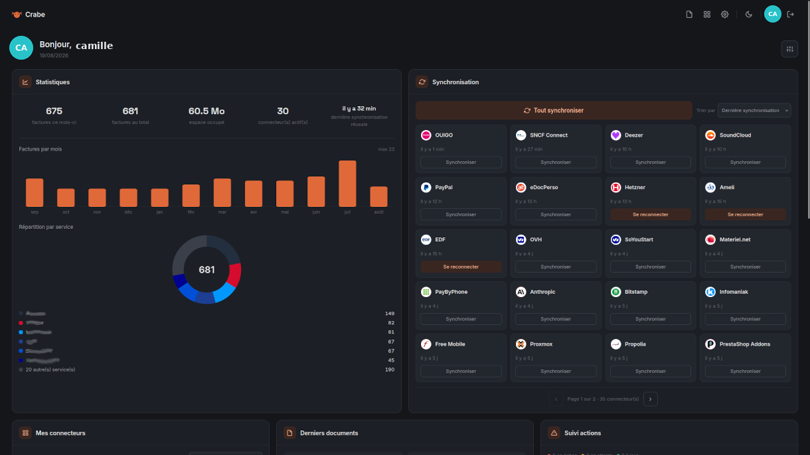

---

## Ce que crabe fait

- Il se connecte aux services que vous avez choisis, avec les identifiants que
  vous lui confiez ou une session que vous ouvrez vous-même dans une fenêtre.
- Il télécharge ce qui est disponible : factures, relevés, attestations,
  bulletins.
- Il range chaque document sous `<vous>/<Service>/<compte>/<année>/`.
- Il recopie le tout vers les espaces de stockage que vous branchez : un
  dossier local, un NAS, un cloud (pCloud, Proton Drive, Nextcloud, Dropbox,
  S3 — tout ce que sait joindre rclone).
- Il repasse tout seul, à la fréquence que vous fixez, et vous prévient par
  courriel s'il n'a pas pu.

## Ce que crabe ne fait pas

- **Il n'invente rien.** Quand un site ne fournit pas de PDF — c'est le cas de
  beaucoup —, crabe le dit clairement au lieu de fabriquer un document et de le
  faire passer pour officiel.
- **Il ne contourne rien.** Un site protégé par un anti-robot reste fermé, et
  crabe l'annonce. Il n'insiste jamais sur un formulaire de connexion : deux
  essais ratés font bloquer un compte.
- **Il n'envoie rien nulle part.** Pas de télémétrie, pas de statistiques, pas
  d'appel à un serveur d'éditeur. La seule requête sortante qui ne concerne pas
  vos services est la vérification de mise à jour — coupée par défaut (voir
  plus bas).
- **Ce n'est pas un coffre-fort légal.** C'est un ramasseur et un rangeur. Vos
  documents restent des fichiers, dans des dossiers, que vous pouvez lire sans
  crabe et emporter le jour où il ne vous plaît plus.

---

## Les services pris en charge

La liste complète, avec l'état de chacun — ceux qui récupèrent déjà des
documents, ceux qui sont écrits mais pas encore essayés, ceux qui attendent
quelque chose, et ceux qui sont seulement annoncés — est dans
[docs/CONNECTEURS.md](docs/CONNECTEURS.md).

---

## Démarrer

Il vous faut Docker. Trois commandes :

```bash
mkdir crabe && cd crabe
curl -O https://raw.githubusercontent.com/TheWorms/crabe/main/docker-compose.yml
docker compose up -d
```

### Le premier écran vous appartient

Ouvrez **http://localhost:3000**. crabe vous accueille en vous demandant de
créer votre compte : un identifiant, un mot de passe, et vous êtes dedans.

Ce compte est celui de l'administrateur — c'est vous. L'écran de création
n'existe qu'à ce moment-là : dès qu'un compte existe, il disparaît pour
toujours, et personne ne peut s'inscrire à votre place. Il n'y a pas
d'inscription publique dans crabe ; les comptes suivants, si vous en voulez,
c'est vous qui les créez dans **Administration › Utilisateurs**.

Ces identifiants ne servent qu'à ouvrir crabe. Ils n'ont aucun rapport avec
vos comptes chez les services, et ils ne sortent pas de chez vous.

### Puis notez la phrase secrète

```bash
sudo cat data/phrase-secrete
```

Au tout premier démarrage, crabe a généré sa **phrase secrète** et l'a écrite
dans `data/phrase-secrete`. Elle chiffre tous les identifiants que vous
enregistrerez : notez-la en lieu sûr. Si vous sauvegardez le dossier `data`,
vous la sauvegardez avec. Elle n'apparaît jamais dans les journaux de crabe :
vous pouvez les partager pour demander de l'aide sans la dévoiler. (`sudo` est
nécessaire : le fichier appartient à l'utilisateur de crabe.)

Pour une installation automatisée (ou si vous préférez tout fixer d'avance),
posez ces variables avant le premier démarrage — le compte est alors créé au
lancement et l'écran d'accueil ne s'affiche jamais :

```yaml
environment:
  CRABE_ADMIN_USERNAME: "camille"
  CRABE_ADMIN_PASSWORD: "un-mot-de-passe-a-vous"
  CRABE_MASTER_PASSPHRASE: "une-phrase-longue-et-privee"
```

---

## Brancher un premier service

Dans le **Store**, choisissez un service dans la liste, puis **Installer**.

Ce que crabe demande dépend du service, et il vous le dit :

- **Un identifiant et un mot de passe** pour les sites qui s'en contentent. Ils
  partent chiffrés dans la base, avec la phrase secrète.
- **Une clé d'API**, quand le service en propose une : c'est toujours le
  meilleur choix, elle se révoque d'un clic et ne donne accès qu'à ce qu'elle
  déclare.
- **Une fenêtre de connexion**, pour les sites qui envoient un code par SMS ou
  par courriel, ou qui passent par « connexion avec Google ». crabe ouvre alors
  une vraie fenêtre de navigateur dans votre navigateur. Vous vous connectez
  vous-même, exactement comme d'habitude, et **vous cliquez « Enregistrer »
  quand vous êtes arrivé sur votre compte**.

  Ce clic est important : c'est lui qui dit à crabe « ça y est, je suis
  connecté, prends la session ». Cliquer trop tôt ne capture rien d'utile, et
  crabe vous le fera remarquer plutôt que de vous laisser croire que c'est fait.

Ensuite : **Récupérer maintenant**. crabe part chercher, et raconte ce qu'il trouve.

### Mettre un service de côté

Un service branché peut être **mis en pause** — l'interrupteur sur sa carte,
dans **Profil › Connecteurs installés**. Il cesse d'aller chercher quoi que ce
soit, et rien d'autre ne change : sa connexion au site reste enregistrée, y
compris celle que vous avez ouverte vous-même dans la fenêtre, les documents
déjà rangés ne bougent pas, et il rattrapera ce qu'il aura manqué le jour où
vous le rallumerez.

C'est ce qu'il faut faire quand un service vous encombre pour un temps.
Désinstaller, c'est autre chose : ça efface les identifiants, et la connexion
serait à refaire entièrement.

---

## Où vont les documents

Par défaut, dans le dossier `data/documents` de votre installation. C'est déjà
un rangement complet, et ça peut suffire.

Dans **Administration › Stockage**, vous pouvez en ajouter d'autres : un
montage réseau, un cloud. Chaque document neuf part vers **tous** les espaces actifs en même
temps — ce ne sont pas des sauvegardes en cascade, ce sont des copies
parallèles. crabe refuse d'éteindre le dernier espace restant, et vous dit
pourquoi.

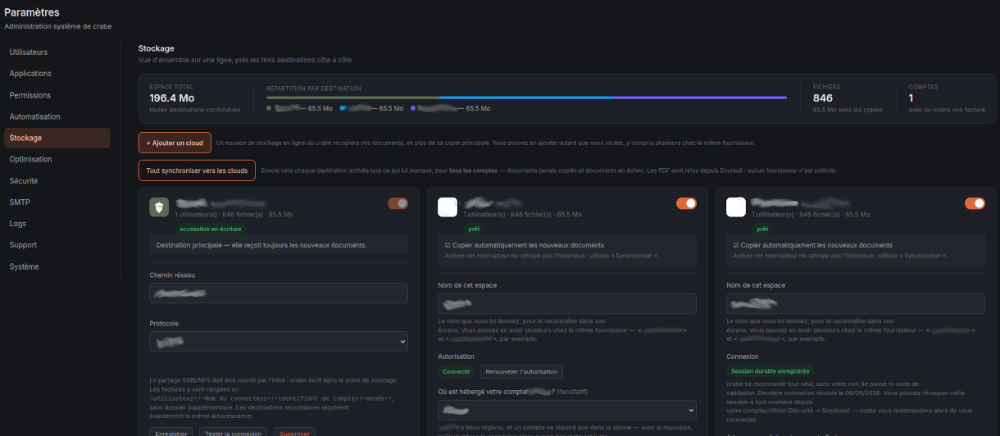

L'arborescence est la même partout, pour que vous vous y retrouviez sans
crabe :

```
camille/
  Free Internet/
    fbx12345678/
      2025/
        2025-11_facture.pdf
      2026/
  eDocPerso/
    ...
```

### Configurer pCloud

pCloud n'accepte plus l'application partagée du logiciel rclone, que crabe
utilise pour parler aux clouds : sans **votre propre application pCloud**, il
refuse la connexion (« Invalid 'client_id' »). Elle s'obtient une fois pour
toutes :

1. Demandez-la sur https://docs.pcloud.com/my_apps/ — pCloud l'approuve à la
   main, dans un délai qu'il n'annonce pas.
2. Dans ses réglages, déclarez l'adresse de redirection
   `http://localhost:53682/`, exactement celle-ci.
3. Dans crabe, **Administration › Stockage** : ajoutez pCloud (« + Ajouter un
   cloud ») ou ouvrez sa carte, puis recopiez l'identifiant de votre
   application dans « Identifiant de l'application » et son secret dans
   « Secret de l'application ». Ils sont rangés chiffrés et ne sont jamais
   réaffichés.
4. Cliquez **Se connecter à pCloud** (ou **Renouveler l'autorisation** sur une
   carte déjà connectée) : crabe enregistre la carte, puis ouvre la page de
   pCloud. Elle demande un accès complet à vos fichiers et dossiers ; acceptez
   (**Allow**) pour que crabe puisse y déposer vos documents.
5. Puis **Tester la connexion** et, pour envoyer les documents déjà rangés,
   **Synchroniser**.

Si la page de pCloud affiche :

- **« Invalid 'client_id' »** — pCloud refuse l'application avec laquelle crabe
  se présente : renseignez votre propre application sur la carte pCloud ; si
  c'est déjà fait, vérifiez l'identifiant recopié.
- **« This 'redirect_uri' is not autorized. »** — l'adresse de redirection
  n'est pas déclarée : ajoutez `http://localhost:53682/`, exactement, dans les
  réglages de votre application chez pCloud, puis relancez la connexion.

---

## Sécurité, franchement

- **La phrase secrète chiffre vos identifiants.** Sans elle, ils sont
  irrécupérables — pas « difficiles à retrouver » : perdus. C'est le prix du
  chiffrement réel. Sauvegardez `data/`, ou fixez-la vous-même avec
  `CRABE_MASTER_PASSPHRASE` pour la tenir hors du volume.
- **Une session capturée vaut vos identifiants** tant qu'elle est valide. Elle
  est chiffrée comme le reste, et crabe n'emporte que les cookies du domaine
  concerné — jamais votre session Google au passage.
- **Le conteneur ne tourne pas en root.** L'application vit sous un utilisateur
  sans privilège, et le port n'écoute que ce que vous publiez.
- **crabe ne répond qu'à votre réseau local.** Par défaut, seuls les appareils
  d'un réseau privé l'ouvrent : la machine elle-même, le réseau de la maison ou
  du bureau (`10.0.0.0/8`, `172.16.0.0/12`, `192.168.0.0/16`, et leurs
  équivalents IPv6), Tailscale (`100.64.0.0/10`). Toute autre adresse voit une
  page « Accès refusé ». Pour choisir vous-même, posez `CRABE_ALLOWED_CIDRS`
  dans `docker-compose.yml` : la liste que vous écrivez remplace celle-ci, et
  `*` ouvre crabe à toutes les adresses — à vos risques, voir le point suivant.
  Le `docker-compose.yml` fourni n'ouvre le port qu'en IPv4 : en IPv6, Docker
  cache l'adresse réelle des appareils. Jusqu'à la version 0.1.9, sans cette
  variable, toutes les adresses passaient.
- **crabe ne fait pas de HTTPS lui-même.** Il sert du HTTP en clair sur son
  port. Sur votre machine ou votre réseau domestique, c'est sans conséquence.
  Si vous l'exposez au-delà, mettez un reverse proxy avec un vrai certificat
  devant — et activez la double authentification depuis votre profil.
- **Confiez-lui ce qui vous met à l'aise.** Un service qui propose une clé
  d'API limitée mérite qu'on l'utilise plutôt qu'un mot de passe principal. Une
  banque mérite peut-être qu'on n'y touche pas du tout. crabe ne vous poussera
  jamais dans un sens ou dans l'autre.
- **Ce logiciel est jeune** et pilote de vrais navigateurs sur de vrais
  comptes. Les sites changent sans prévenir, un connecteur peut cesser de
  marcher du jour au lendemain. Quand c'est le cas, crabe le dit — il ne prétend
  pas avoir réussi.

---

## Configurer

Rien n'est obligatoire pour démarrer. Toutes les variables sont documentées
dans [`.env.example`](.env.example) : envoi de courriel, fuseau, dossier de
données, phrase secrète et compte administrateur imposés.

### Sauvegarder et restaurer

Tout ce que crabe garde est dans le dossier `data` : la base, la phrase secrète
(`data/phrase-secrete`), le sel qui va avec (`data/master.salt`), vos documents
(`data/documents`) et les connexions ouvertes aux sites. Gardez aussi votre
`docker-compose.yml`, surtout si vous y avez écrit la phrase secrète. Pour une
copie complète, crabe arrêté :

```bash
docker compose stop
sudo tar czf ../crabe-sauvegarde-$(date +%Y-%m-%d).tar.gz data docker-compose.yml
docker compose start
```

L'archive contient vos sessions ouvertes sur les sites : protégez-la comme un
mot de passe, et gardez-la ailleurs que sur la machine de crabe. Si vos
documents sont sur un autre disque monté dans le conteneur, ils ne sont pas
dans `data` : sauvegardez-les à part.

Pour restaurer, sur cette machine ou une autre, remettez `data` et
`docker-compose.yml` **avant le premier `docker compose up`**, en gardant les
propriétaires des fichiers (`sudo tar xzf …`). crabe vérifie sa clé au
démarrage : sans `data/phrase-secrete` (ni la variable `CRABE_MASTER_PASSPHRASE`
d'origine), ou avec une autre phrase ou un autre sel, il refuse de démarrer
plutôt que de rendre vos identifiants illisibles, et son journal
(`docker compose logs`) dit quoi remettre.

crabe fait aussi sa propre copie de la base juste avant de la mettre à jour
(`data/crabe.db.avant-migration-…`, les trois plus récentes) : elle sert à
revenir en arrière, elle ne remplace pas la vôtre.

### Mise à jour

crabe ne se met jamais à jour tout seul : il peut vous prévenir qu'une nouvelle version existe, et la mise à jour tient en deux commandes Docker.
Tout est expliqué pas à pas dans [docs/MISE-A-JOUR.md](docs/MISE-A-JOUR.md) (English: [docs/UPDATING.md](docs/UPDATING.md)).
Les nouveautés de chaque version sont dans le journal des versions : [CHANGELOG.md](CHANGELOG.md).

---

## À quoi ça ressemble

Le Store, où chaque service annonce honnêtement son état — disponible, pas
encore testé, ou impossible aujourd'hui (et pourquoi) :

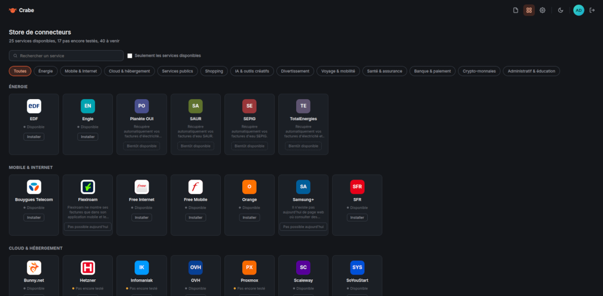

Ce que chaque connecteur a le droit de lire et d'écrire, dit en français :

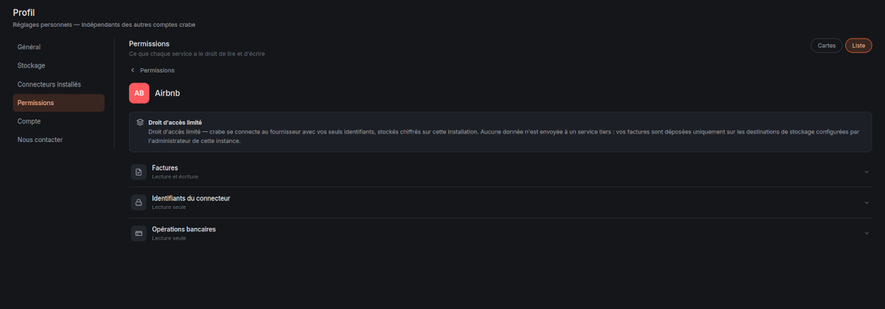

Vos documents, dans l'explorateur — un arbre des services et des années, une liste de fichiers et un panneau de détail :

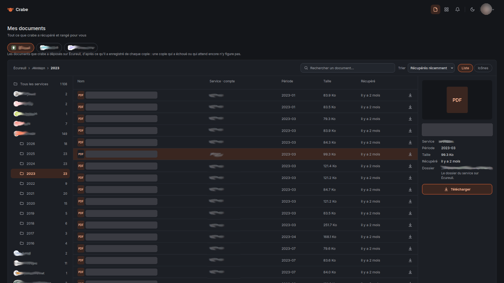

Côté profil, le choix de l'interface des documents, puis la convention de nommage des fichiers — avec le renommage de ceux déjà déposés :

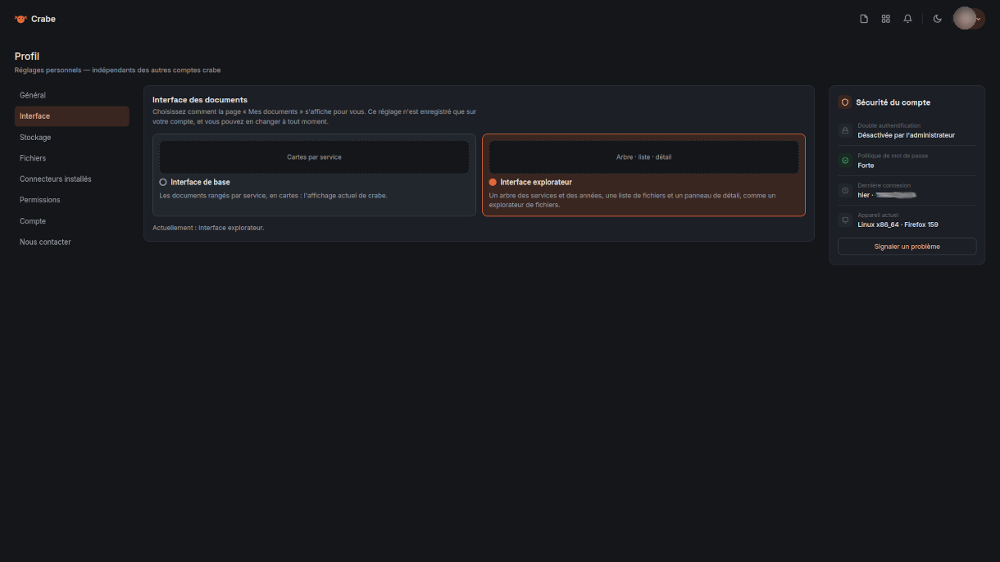

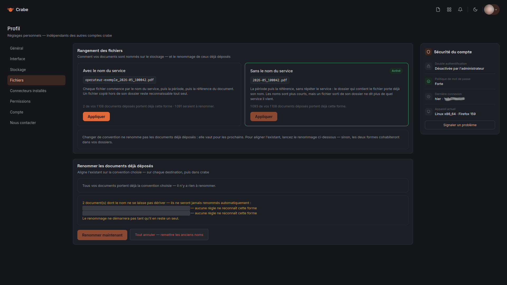

La fiche d'un service — ses derniers documents, ses comptes, et les destinations où ils sont rangés :

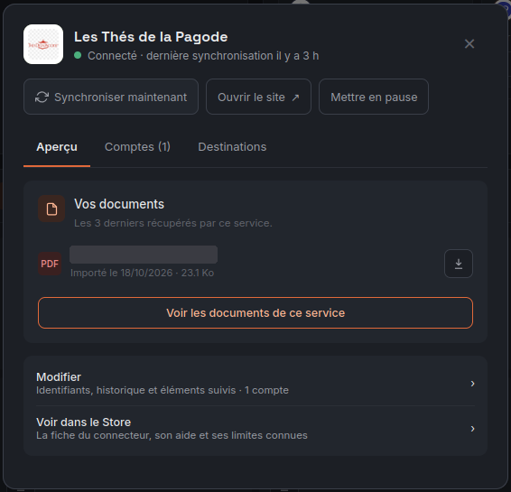

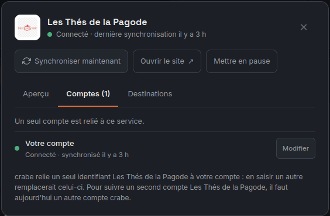

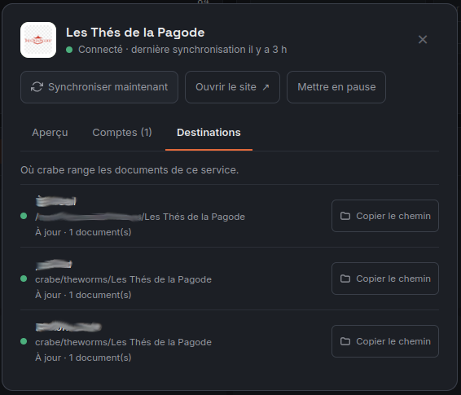

Et côté administration — le catalogue, la politique de sécurité, les rôles :

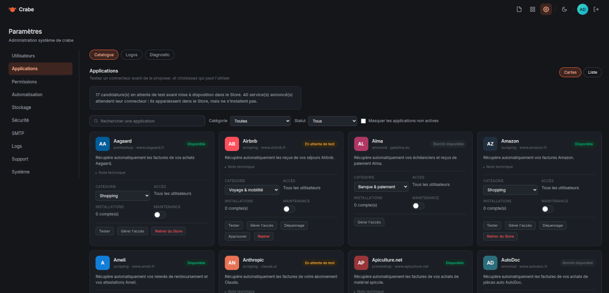

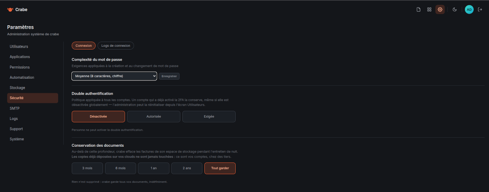

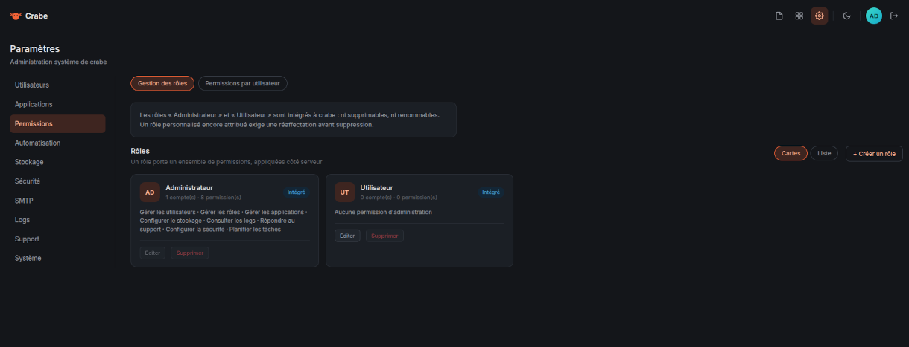

---

## Signaler un problème

Un service n'arrive plus à récupérer vos documents ? Il suffit d'activer les
logs et de nous les envoyer : ils disent, page par page, ce que crabe a fait,
ce qu'il cherchait et ce qu'il a trouvé à la place — de quoi corriger sans
avoir de compte sur ce service.

1. **Activez les logs** : dans **Administration › Logs › Réglages**, ouvrez
   « Le déroulé complet » et « Le rapport lisible à l'écran » (ils sont fermés
   par défaut).
2. **Relancez le service** : sur sa fiche, **Récupérer maintenant**.
3. **Envoyez-nous le rapport** : dans **Administration › Logs › Connecteurs**,
   sur la ligne de cette récupération, **Détail** montre son déroulé, et
   **Rapport** le télécharge. Joignez le fichier à une
   [issue](https://github.com/TheWorms/crabe/issues) en disant ce que vous
   attendiez.

crabe retire du rapport les noms de compte, les adresses e-mail, les numéros
de téléphone, les adresses IP, les jetons et le détail des adresses web. Quand
la page a pu être relevée, c'est une archive : avec le texte, la structure de
la page (chaque texte remplacé par sa longueur) et une capture où chaque texte
et chaque image sont effacés. Relisez-le quand même avant de l'envoyer.

Pour suivre chaque étape d'un service, même quand il réussit :

```bash
docker compose exec crabe node bin/crabe.js recuperer <service> --detail
```

---

## Contribuer

Les connecteurs sont des fichiers autonomes : un `manifest.json` qui décrit ce
que le service demande, un `connector.js` qui va chercher. En ajouter un ne
demande pas de toucher au reste.

La règle du projet tient en une phrase : **une réponse n'est pas une preuve,
c'est son contenu qui en est une.** Un connecteur qui reçoit un code 200 n'a
rien prouvé tant qu'il n'a pas vu la liste des documents. Un fichier téléchargé
n'est un PDF que si ses premiers octets le disent. Les notes techniques des
manifestes existants montrent le niveau de mesure attendu — elles racontent ce
qui a été observé, pas ce qui devrait marcher.

Ouvrez une *issue* avant un gros morceau, qu'on en parle.

---

## Licence

[AGPL-3.0-only](LICENSE). Vous pouvez l'utiliser, l'étudier, le modifier et le
redistribuer. Si vous le proposez comme service à d'autres, vous devez leur
donner accès à votre version modifiée. C'est délibéré : un logiciel qui
manipule les identifiants de ses utilisateurs doit rester lisible par eux.
